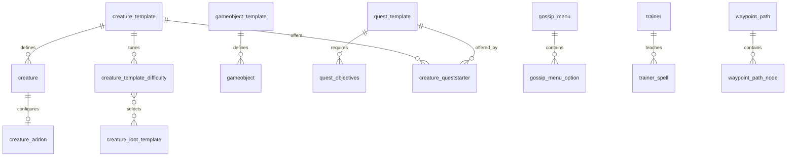

# Logical relationships

[Database documentation](README.md)

No SQL foreign keys were reported for the captured world schema. The graph and catalog describe logical associations, not enforcement. Presence of a key or index does not guarantee referential integrity. Zero/signed sentinel values and polymorphic selectors need loader-specific treatment.

## Association catalog

| From | To | Interpretation |
| --- | --- | --- |
| [achievement_reward_locale.ID](tables/achievement_reward_locale.md) | [achievement_reward.ID](tables/achievement_reward.md) | Translation parent identity; include all identity components plus locale. |
| [creature.id](tables/creature.md) | [creature_template.entry](tables/creature_template.md) | Template identity shared by NPC spawns. |
| [creature_addon.guid](tables/creature_addon.md) | [creature.guid](tables/creature.md) | Per-spawn addon; template addon provides defaults. |
| [creature_movement_override.SpawnId](tables/creature_movement_override.md) | [creature.guid](tables/creature.md) | Per-spawn movement settings. |
| [creature_questender.id](tables/creature_questender.md) | [creature_template.entry](tables/creature_template.md) | Creature template identity, not spawn GUID. |
| [creature_questender.quest](tables/creature_questender.md) | [quest_template.ID](tables/quest_template.md) | Quest offer/turn-in relationship. |
| [creature_queststarter.id](tables/creature_queststarter.md) | [creature_template.entry](tables/creature_template.md) | Creature template identity, not spawn GUID. |
| [creature_queststarter.quest](tables/creature_queststarter.md) | [quest_template.ID](tables/quest_template.md) | Quest offer/turn-in relationship. |
| [creature_template.CreatureImmunitiesId](tables/creature_template.md) | [creature_immunities.ID](tables/creature_immunities.md) | Reusable immunity definition. |
| [creature_template_addon.entry](tables/creature_template_addon.md) | [creature_template.entry](tables/creature_template.md) | Template extension. |
| [creature_template_difficulty.Entry](tables/creature_template_difficulty.md) | [creature_template.entry](tables/creature_template.md) | Template extension. |
| [creature_template_difficulty.LootID](tables/creature_template_difficulty.md) | [creature_loot_template.Entry](tables/creature_loot_template.md) | Loot entry may differ from creature entry. |
| [creature_template_difficulty.PickPocketLootID](tables/creature_template_difficulty.md) | [pickpocketing_loot_template.Entry](tables/pickpocketing_loot_template.md) | Pickpocket loot entry. |
| [creature_template_difficulty.SkinLootID](tables/creature_template_difficulty.md) | [skinning_loot_template.Entry](tables/skinning_loot_template.md) | Skinning loot entry. |
| [creature_template_gossip.CreatureID](tables/creature_template_gossip.md) | [creature_template.entry](tables/creature_template.md) | Template extension. |
| [creature_template_gossip.MenuID](tables/creature_template_gossip.md) | [gossip_menu.MenuID](tables/gossip_menu.md) | Available menu. |
| [creature_template_locale.entry](tables/creature_template_locale.md) | [creature_template.entry](tables/creature_template.md) | Translation parent identity; include all identity components plus locale. |
| [creature_template_model.CreatureDisplayID](tables/creature_template_model.md) | [creature_model_info.DisplayID](tables/creature_model_info.md) | Display model metadata. |
| [creature_template_model.CreatureID](tables/creature_template_model.md) | [creature_template.entry](tables/creature_template.md) | Template extension. |
| [creature_template_movement.CreatureId](tables/creature_template_movement.md) | [creature_template.entry](tables/creature_template.md) | Template extension. |
| [creature_template_resistance.CreatureID](tables/creature_template_resistance.md) | [creature_template.entry](tables/creature_template.md) | Template extension. |
| [creature_template_sparring.Entry](tables/creature_template_sparring.md) | [creature_template.entry](tables/creature_template.md) | Template extension. |
| [creature_template_spell.CreatureID](tables/creature_template_spell.md) | [creature_template.entry](tables/creature_template.md) | Template extension. |
| [creature_text.CreatureID](tables/creature_text.md) | [creature_template.entry](tables/creature_template.md) | Creature template identity, not spawn GUID. |
| [creature_text_locale.CreatureID](tables/creature_text_locale.md) | [creature_text.CreatureID](tables/creature_text.md) | Translation parent identity; include all identity components plus locale. |
| [creature_text_locale.GroupID](tables/creature_text_locale.md) | [creature_text.GroupID](tables/creature_text.md) | Translation parent identity; include all identity components plus locale. |
| [creature_text_locale.ID](tables/creature_text_locale.md) | [creature_text.ID](tables/creature_text.md) | Translation parent identity; include all identity components plus locale. |
| [game_event_arena_seasons.eventEntry](tables/game_event_arena_seasons.md) | [game_event.eventEntry](tables/game_event.md) | Event identity; signed event fields require sign-aware interpretation. |
| [game_event_condition.eventEntry](tables/game_event_condition.md) | [game_event.eventEntry](tables/game_event.md) | Event identity; signed event fields require sign-aware interpretation. |
| [game_event_creature.eventEntry](tables/game_event_creature.md) | [game_event.eventEntry](tables/game_event.md) | Event identity; signed event fields require sign-aware interpretation. |
| [game_event_creature.guid](tables/game_event_creature.md) | [creature.guid](tables/creature.md) | Event-controlled NPC spawn. |
| [game_event_creature_quest.eventEntry](tables/game_event_creature_quest.md) | [game_event.eventEntry](tables/game_event.md) | Event identity; signed event fields require sign-aware interpretation. |
| [game_event_gameobject.eventEntry](tables/game_event_gameobject.md) | [game_event.eventEntry](tables/game_event.md) | Event identity; signed event fields require sign-aware interpretation. |
| [game_event_gameobject.guid](tables/game_event_gameobject.md) | [gameobject.guid](tables/gameobject.md) | Event-controlled object spawn. |
| [game_event_gameobject_quest.eventEntry](tables/game_event_gameobject_quest.md) | [game_event.eventEntry](tables/game_event.md) | Event identity; signed event fields require sign-aware interpretation. |
| [game_event_model_equip.eventEntry](tables/game_event_model_equip.md) | [game_event.eventEntry](tables/game_event.md) | Event identity; signed event fields require sign-aware interpretation. |
| [game_event_npc_vendor.eventEntry](tables/game_event_npc_vendor.md) | [game_event.eventEntry](tables/game_event.md) | Event identity; signed event fields require sign-aware interpretation. |
| [game_event_npcflag.eventEntry](tables/game_event_npcflag.md) | [game_event.eventEntry](tables/game_event.md) | Event identity; signed event fields require sign-aware interpretation. |
| [game_event_pool.eventEntry](tables/game_event_pool.md) | [game_event.eventEntry](tables/game_event.md) | Event identity; signed event fields require sign-aware interpretation. |
| [game_event_prerequisite.eventEntry](tables/game_event_prerequisite.md) | [game_event.eventEntry](tables/game_event.md) | Dependent event. |
| [game_event_prerequisite.eventEntry](tables/game_event_prerequisite.md) | [game_event.eventEntry](tables/game_event.md) | Event identity; signed event fields require sign-aware interpretation. |
| [game_event_prerequisite.prerequisite_event](tables/game_event_prerequisite.md) | [game_event.eventEntry](tables/game_event.md) | Prerequisite event. |
| [game_event_quest_condition.eventEntry](tables/game_event_quest_condition.md) | [game_event.eventEntry](tables/game_event.md) | Event identity; signed event fields require sign-aware interpretation. |
| [game_event_seasonal_questrelation.eventEntry](tables/game_event_seasonal_questrelation.md) | [game_event.eventEntry](tables/game_event.md) | Event identity; signed event fields require sign-aware interpretation. |
| [gameobject.id](tables/gameobject.md) | [gameobject_template.entry](tables/gameobject_template.md) | Template identity shared by gameobject spawns. |
| [gameobject_addon.guid](tables/gameobject_addon.md) | [gameobject.guid](tables/gameobject.md) | Per-spawn addon. |
| [gameobject_questender.id](tables/gameobject_questender.md) | [gameobject_template.entry](tables/gameobject_template.md) | Gameobject template identity. |
| [gameobject_questender.quest](tables/gameobject_questender.md) | [quest_template.ID](tables/quest_template.md) | Quest offer/turn-in relationship. |
| [gameobject_queststarter.id](tables/gameobject_queststarter.md) | [gameobject_template.entry](tables/gameobject_template.md) | Gameobject template identity. |
| [gameobject_queststarter.quest](tables/gameobject_queststarter.md) | [quest_template.ID](tables/quest_template.md) | Quest offer/turn-in relationship. |
| [gameobject_template_locale.entry](tables/gameobject_template_locale.md) | [gameobject_template.entry](tables/gameobject_template.md) | Translation parent identity; include all identity components plus locale. |
| [gossip_menu.TextID](tables/gossip_menu.md) | [npc_text.ID](tables/npc_text.md) | NPC text for the menu. |
| [gossip_menu_option.ActionMenuID](tables/gossip_menu_option.md) | [gossip_menu.MenuID](tables/gossip_menu.md) | Submenu navigation; zero may mean no navigation. |
| [gossip_menu_option.ActionPoiID](tables/gossip_menu_option.md) | [points_of_interest.ID](tables/points_of_interest.md) | Map point shown by selection. |
| [gossip_menu_option.MenuID](tables/gossip_menu_option.md) | [gossip_menu.MenuID](tables/gossip_menu.md) | Menu containing the option. |
| [gossip_menu_option_locale.MenuID](tables/gossip_menu_option_locale.md) | [gossip_menu_option.MenuID](tables/gossip_menu_option.md) | Translation parent identity; include all identity components plus locale. |
| [gossip_menu_option_locale.OptionID](tables/gossip_menu_option_locale.md) | [gossip_menu_option.OptionID](tables/gossip_menu_option.md) | Translation parent identity; include all identity components plus locale. |
| [npc_vendor.entry](tables/npc_vendor.md) | [creature_template.entry](tables/creature_template.md) | Creature template identity, not spawn GUID. |
| [page_text.NextPageID](tables/page_text.md) | [page_text.ID](tables/page_text.md) | Next readable page; prevent cycles. |
| [page_text_locale.ID](tables/page_text_locale.md) | [page_text.ID](tables/page_text.md) | Translation parent identity; include all identity components plus locale. |
| [playerchoice_locale.ChoiceId](tables/playerchoice_locale.md) | [playerchoice.ChoiceId](tables/playerchoice.md) | Translation parent identity; include all identity components plus locale. |
| [playerchoice_response.ChoiceId](tables/playerchoice_response.md) | [playerchoice.ChoiceId](tables/playerchoice.md) | Responses belonging to a choice. |
| [playerchoice_response_locale.ChoiceId](tables/playerchoice_response_locale.md) | [playerchoice_response.ChoiceId](tables/playerchoice_response.md) | Translation parent identity; include all identity components plus locale. |
| [playerchoice_response_locale.ResponseId](tables/playerchoice_response_locale.md) | [playerchoice_response.ResponseId](tables/playerchoice_response.md) | Translation parent identity; include all identity components plus locale. |
| [points_of_interest_locale.ID](tables/points_of_interest_locale.md) | [points_of_interest.ID](tables/points_of_interest.md) | Translation parent identity; include all identity components plus locale. |
| [pool_members.poolSpawnId](tables/pool_members.md) | [pool_template.entry](tables/pool_template.md) | Parent pool; member spawnId is typed. |
| [quest_completion_log_conditional.QuestId](tables/quest_completion_log_conditional.md) | [quest_template.ID](tables/quest_template.md) | Parent quest. |
| [quest_description_conditional.QuestId](tables/quest_description_conditional.md) | [quest_template.ID](tables/quest_template.md) | Parent quest. |
| [quest_greeting_locale.ID](tables/quest_greeting_locale.md) | [quest_greeting.ID](tables/quest_greeting.md) | Translation parent identity; include all identity components plus locale. |
| [quest_mail_sender.QuestId](tables/quest_mail_sender.md) | [quest_template.ID](tables/quest_template.md) | Parent quest. |
| [quest_objectives.ParentObjectiveID](tables/quest_objectives.md) | [quest_objectives.ID](tables/quest_objectives.md) | Objective dependency. |
| [quest_objectives.QuestID](tables/quest_objectives.md) | [quest_template.ID](tables/quest_template.md) | Parent quest. |
| [quest_objectives_completion_effect.ObjectiveID](tables/quest_objectives_completion_effect.md) | [quest_objectives.ID](tables/quest_objectives.md) | Objective completion effect. |
| [quest_objectives_locale.ID](tables/quest_objectives_locale.md) | [quest_objectives.ID](tables/quest_objectives.md) | Translation parent identity; include all identity components plus locale. |
| [quest_offer_reward_conditional.QuestId](tables/quest_offer_reward_conditional.md) | [quest_template.ID](tables/quest_template.md) | Parent quest. |
| [quest_offer_reward_locale.ID](tables/quest_offer_reward_locale.md) | [quest_offer_reward.ID](tables/quest_offer_reward.md) | Translation parent identity; include all identity components plus locale. |
| [quest_poi.QuestID](tables/quest_poi.md) | [quest_template.ID](tables/quest_template.md) | Parent quest. |
| [quest_poi_points.QuestID](tables/quest_poi_points.md) | [quest_template.ID](tables/quest_template.md) | Also join blob keys to quest_poi. |
| [quest_poi_points.QuestID](tables/quest_poi_points.md) | [quest_template.ID](tables/quest_template.md) | Parent quest. |
| [quest_pool_members.poolId](tables/quest_pool_members.md) | [quest_pool_template.poolId](tables/quest_pool_template.md) | Rotating quest pool. |
| [quest_pool_members.questId](tables/quest_pool_members.md) | [quest_template.ID](tables/quest_template.md) | Parent quest. |
| [quest_pool_members.questId](tables/quest_pool_members.md) | [quest_template.ID](tables/quest_template.md) | Quest selected by pool. |
| [quest_request_items_conditional.QuestId](tables/quest_request_items_conditional.md) | [quest_template.ID](tables/quest_template.md) | Parent quest. |
| [quest_request_items_locale.ID](tables/quest_request_items_locale.md) | [quest_request_items.ID](tables/quest_request_items.md) | Translation parent identity; include all identity components plus locale. |
| [quest_reward_choice_items.QuestID](tables/quest_reward_choice_items.md) | [quest_template.ID](tables/quest_template.md) | Parent quest. |
| [quest_reward_display_spell.QuestID](tables/quest_reward_display_spell.md) | [quest_template.ID](tables/quest_template.md) | Parent quest. |
| [quest_reward_house_decor.QuestID](tables/quest_reward_house_decor.md) | [quest_template.ID](tables/quest_template.md) | Parent quest. |
| [quest_reward_house_room.QuestID](tables/quest_reward_house_room.md) | [quest_template.ID](tables/quest_template.md) | Parent quest. |
| [quest_template_locale.ID](tables/quest_template_locale.md) | [quest_template.ID](tables/quest_template.md) | Translation parent identity; include all identity components plus locale. |
| [quest_treasure_pickers.QuestID](tables/quest_treasure_pickers.md) | [quest_template.ID](tables/quest_template.md) | Parent quest. |
| [spawn_group.groupId](tables/spawn_group.md) | [spawn_group_template.groupId](tables/spawn_group_template.md) | Group definition. |
| [spell_group_stack_rules.group_id](tables/spell_group_stack_rules.md) | [spell_group.id](tables/spell_group.md) | Stacking rule for group. |
| [trainer_locale.Id](tables/trainer_locale.md) | [trainer.Id](tables/trainer.md) | Translation parent identity; include all identity components plus locale. |
| [trainer_spell.TrainerId](tables/trainer_spell.md) | [trainer.Id](tables/trainer.md) | Spells available from trainer. |
| [waypoint_path_node.PathId](tables/waypoint_path_node.md) | [waypoint_path.PathId](tables/waypoint_path.md) | Ordered nodes within a path. |

## Polymorphic and external relationships

- conditions source fields refer to different world tables according to SourceTypeOrReferenceId; predicate operands depend on ConditionTypeOrReference.
- smart_scripts ownership depends on source_type; negative entryorguid selects a spawn where supported. Event/action/target parameters are typed operands.
- Loot ItemType selects an item, currency, reference entry, or another supported reward kind; do not assume every Item value is an item ID.
- spawn_group, pool_members, linked_respawn, and spawn_tracking use type discriminators for creature/gameobject/pool IDs.
- gameobject_template Data slots are selected by type.
- Spell, item, faction, map, area, display, broadcast text, difficulty, and many modern quest reward IDs refer to client DB2/hotfix data. They need not have a world table with the same name.
- Localized tables often have composite parent identities. Joining only the first key can duplicate or misassociate text.
